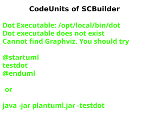
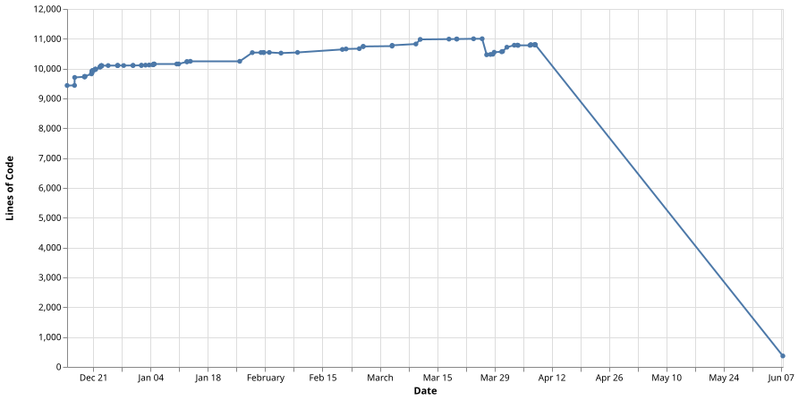

# ScriptCollection-reference

## Code-units-overview

## Lines-of-code

## Findings

| Id    | State | Description                                                                                                                                                                                                                                                                                                                                                                                                                                                                                              | Impact                                                                                                                                                                                                                                                                                                                                                                                        | Notes                                                                                                                                                                                                                                                                                                     |
| ----- | ----- | -------------------------------------------------------------------------------------------------------------------------------------------------------------------------------------------------------------------------------------------------------------------------------------------------------------------------------------------------------------------------------------------------------------------------------------------------------------------------------------------------------- | --------------------------------------------------------------------------------------------------------------------------------------------------------------------------------------------------------------------------------------------------------------------------------------------------------------------------------------------------------------------------------------------- | --------------------------------------------------------------------------------------------------------------------------------------------------------------------------------------------------------------------------------------------------------------------------------------------------------- |
| SEC-1 | open  | The Dockerfiles of `SCBuilder`, `SCGitHubRunner` and `SCTaskRunnerAndroid` download binaries and archives (for example the GitHub-actions-runner, the runner-container-hooks, Temurin, Kotlin, Epew, jq, yq, shellcheck, git-lfs, gh, glab, kubectl, helm, kustomize, Go, Node and the Android-command-line-tools) without verifying a checksum or a signature, and they run remote install-scripts directly (`curl https://sh.rustup.rs | sh`). | A compromised or replaced upstream-artifact (or a compromised download-host) ends up unnoticed in the images, and from there in every build-pipeline and every runner which uses them, including the secrets these pipelines have access to (supply-chain-attack).                                                                                                                            | Not trivially fixable: an expected checksum per artifact, version and architecture has to be pinned next to the corresponding `Other/Resources/Dependencies/<Tool>/Version.txt` and has to be maintained by `Other/UpdateDependency.py`.                                                                  |
| SEC-2 | open  | `.github/workflows/buildpipeline.yml` uses unpinned dependencies: the job-container `aniondev/scbuilder:latest`, `pip3 install scriptcollection --upgrade` and the actions `actions/checkout@v4` and `actions/upload-artifact@v4` by a movable major-tag instead of a commit-hash.                                                                                                                                                                                                                       | A new (possibly compromised) version of one of these dependencies is executed in the pipeline without any change in this repository, with access to the docker-socket of the runner-host and to the secrets of the pipeline; builds are additionally not reproducible.                                                                                                                        | Not trivially fixable: the tag `latest` comes from `.ScriptCollection/OCIImages/ImageDefinition.csv` and ScriptCollection asserts that the workflow uses the image defined there, so the pin has to be changed in both places and kept up to date by the dependency-update-process.                       |
| SEC-3 | open  | `SCGitHubRunner` is registered for a whole GitHub-organization, runs as `root`, requires the docker-socket of the host and (if `SCRIPTCOLLECTION_CONFIGURATION_FOLDER` is set) mounts the ScriptCollection-configuration-folder of the host into every job-container (`SCGitHubRunner/SCGitHubRunner/ContainerHooks/PrepareJobMountHook.js`).                                                                                                                                                            | Every workflow of every repository of the organization which is allowed to use this runner can read the secrets of the configuration-folder (for example `TFCPS/EnvironmentVariables.csv`) and can get root-access to the runner-host through the docker-socket; if a public repository with workflows for pull-requests from forks uses this runner, an external person can do that as well. | The behaviour is intended and documented in `SCGitHubRunner/Other/Reference/ReferenceContent/Articles/Usage.md`, but the trust-boundary is not stated there. Mitigation: restrict the runner to a runner-group with trusted private repositories only and use a separate configuration-folder per runner. |
| SEC-4 | open  | The task-runners (`SCTaskRunnerAndroid`, `SCTaskRunnerIOS`, `SCTaskRunnerMacOS`, `SCTaskRunnerWindows`) are served over plain http when `SCTaskRunner_CertificateFile` and `SCTaskRunner_CertificateKeyFile` are not set, while the clients authenticate with basic-auth.                                                                                                                                                                                                                                | Without a TLS-terminating reverse-proxy in front of the runner, the credentials and the transferred repository-content (which can contain secrets) are sent unencrypted, so a person in the network can read them and can then start arbitrary programs on the runner-host.                                                                                                                   | Plain http is intended for the case that TLS is terminated by a reverse-proxy, as documented in the ReadMe-files of the task-runners. Making TLS mandatory would need an explicit opt-out-variable for the reverse-proxy-case.                                                                            |
| BLD-1 | open  | The `Epew.deb` in the release-artifact of Epew (`Epew_Artifacts_v<version>.zip`, checked for 5.0.25) declares `Architecture: all`, but its `usr/bin/EpewContent/Epew` is a native x86-64-apphost (ELF-machine `0x3e`). The `SCBuilder`-Dockerfile installs this deb. | An `SCBuilder`-image built for `Platform.Linux_ARM64` contains an epew which can not be executed, so every pipeline which uses epew in that image fails. The amd64-image is not affected. | Root-cause is in the Epew-project, not here. Fix there: either build one deb per architecture (`Architecture: amd64`/`arm64`, with the content of `BuildResult_DotNet_linux-x64`/`-arm64`, which are already part of the zip) or make the deb really architecture-independent (`UseAppHost=false` and a launcher-script which runs `dotnet Epew.dll`). Afterwards raise `Other/Resources/Dependencies/Epew/Version.txt` and adapt the deb-path in the Dockerfile if required. |
| BLD-2 | open  | The `SCBuilder`-Dockerfile installs `/tmp/epew/BuildResult_Deb/Epew.deb`, but the Epew-zip (checked for 5.0.24 and 5.0.25) contains the deb at `Epew/BuildResult_Deb/Epew.deb`, so after `unzip -d /tmp/epew` it is located at `/tmp/epew/Epew/BuildResult_Deb/Epew.deb`. | Assumption (not verified by an image-build): the epew-installation-step fails, so the image can not be built at all, for amd64 as well. | Verify with an image-build first. If confirmed, either adapt the path in the Dockerfile or (if the folder `Epew/` in the zip is unintended) fix the artifact-layout in the Epew-project. |
| BLD-3 | open  | The `SCTaskRunnerAndroid`-Dockerfile still uses the fixed build-argument `PlatformForJavaVersion=x64` for the Temurin-download. | An `SCTaskRunnerAndroid`-image built for arm64 would contain an x64-JDK which can not be executed. Currently only relevant if arm64 is enabled for that codeunit. | Can be fixed like in the `SCBuilder`-Dockerfile: map `dpkg --print-architecture` (`amd64`/`arm64`) to the temurin-token (`x64`/`aarch64`) and fail for other architectures. Whether the Android-tooling of that image supports arm64 at all has to be checked separately. |
| BLD-4 | open  | The `SCBuilder`-image has never been built for `Platform.Linux_ARM64` (it is commented out in `SCBuilder/Other/Build/Build.py`). The Dockerfile was adapted for it (java, node). Checked and arm64-capable: go (`PlatformForGoVersion` is passed per platform by ScriptCollection), dotnet (packages.microsoft.com provides `dotnet-sdk-10.0` for debian-13-arm64), docker, the cli-tools (jq, yq, shellcheck, git-lfs, gh, glab, kubectl, helm, kustomize), the apt-packages of the image (available for trixie-arm64 according to packages.debian.org) and `scdownloadcachabletools` (ScriptCollection selects the JRE-architecture at runtime). Only assumed: `playwright install --with-deps chromium firefox webkit` supports debian-arm64 for all three browsers, `flutter precache`/`flutter doctor` work on a linux-arm64-host, and the npm-/pip-packages (ai-clis, azure-cli, mistral-vibe) provide arm64-builds. | An arm64-image-build can still fail at one of these steps or produce an image in which one of these tools does not work. | Verify by enabling `Platform.Linux_ARM64` in `Build.py` and running a complete image-build (requires a multi-platform-capable buildx-builder, see `SCBuilder/SCBuilder/EntryPoint.sh`). BLD-1 has to be fixed first. |
| BLD-5 | open  | `SCBuilder/Other/Resources/Dependencies/Chromium/Version.txt` pins `150.0.7871.181-1~deb13u1`, but packages.debian.org lists `154.0.8037.92-1~deb13u1` as the chromium-version of trixie (checked 2026-10-11 for amd64 and arm64). The debian-mirror carries only one chromium-version per suite (see the comment in the Dockerfile). | Assumption (not verified by an image-build): `apt-get install chromium=<pinned version>` fails with "Version ... was not found", so the image can not be built at all, for amd64 and arm64. | Raise the pin to the current version of the suite and verify that this build passes the chromium-smoke-test of the Dockerfile. `Other/UpdateDependency.py` does not update chromium yet (`__update_dependency_chromium` is a TODO), which is why this happens repeatedly. |
